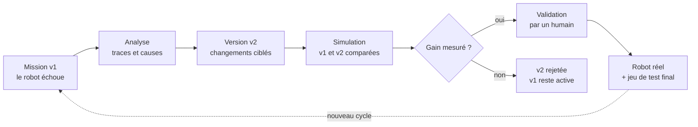

# AutoAlfred — Raison d'être, état de l'art et scénario de démo

*Mis à jour le 19 novembre 2026. Version collaborative : [doc en ligne](https://claude.ai/artifact/JGhLwi639ShBmdzFrCFxRU).*

## En bref

AutoAlfred est un robot humanoïde qui améliore lui-même sa façon d'exécuter des missions, sans réentraîner son modèle d'IA. Il analyse ses échecs, propose une nouvelle version de ses consignes et procédures (le *harness*), la teste en simulation, et ne la garde que si le gain est mesuré et validé par un humain.

Ce qu'il apporte par rapport aux travaux existants : la boucle d'auto-amélioration tourne sur un vrai robot à moins de 1 500 €, avec une plateforme qui rend les progrès visibles et vérifiables.

## Pourquoi ce projet existe

Un robot piloté par un modèle d'IA refait aujourd'hui les mêmes erreurs d'une mission à l'autre. Pour l'améliorer, il existe deux voies, et aucune ne convient à une petite équipe.

| Voie | Ce qu'on change | Limite |
| --- | --- | --- |
| Réentraîner le modèle | Les poids du modèle | Des milliers de démonstrations et beaucoup de calcul |
| Corriger à la main | Consignes, procédures, règles en cas d'erreur | Fait au feeling, sans mesure ni retour arrière |
| **AutoAlfred** | **Le harness, automatiquement** | **Chaque changement est mesuré, lisible et réversible** |

AutoAlfred automatise la deuxième voie. Le modèle ne change jamais : seul le harness évolue. Les garde-fous et le jeu de test final restent hors de portée de l'agent, qui ne peut pas modifier ce qui le juge.

## État de l'art

L'auto-amélioration du harness est un sujet très actif en 2026, mais presque uniquement en logiciel ou en simulation. Les chiffres ci-dessous viennent de résumés et de comptes rendus, pas des articles complets : ils sont à vérifier avant d'être cités.

| Famille | Travaux | Ce qu'ils font | Ce qui manque pour nous |
| --- | --- | --- | --- |
| Robots pilotés par IA (depuis 2022) | SayCan, Code as Policies, RT-2, OpenVLA, π0, Gemini Robotics | Le modèle planifie ou produit directement les mouvements | N'apprennent pas de leurs échecs une fois déployés |
| Analyse des échecs | [REFLECT](https://arxiv.org/abs/2306.15724v3) (Stanford, CoRL 2023) | Explique l'échec d'un robot et propose un nouveau plan | La correction ne vaut que pour cette mission, rien n'est retenu |
| Agents qui apprennent de leur expérience | Reflexion (2023), Voyager (2023) | Leçons écrites après chaque échec, bibliothèque de savoir-faire | Pas de mesure systématique avant d'adopter un changement |
| Optimisation des consignes | [GEPA](https://www.deeplearning.ai/the-batch/authors-devised-gepa-an-algorithm-for-better-prompts-to-improve-agentic-systems-performance) (2025) | Fait évoluer les consignes en analysant les essais ; mieux que l'apprentissage par renforcement avec jusqu'à 35 fois moins d'essais | Logiciel uniquement |
| Agents qui réécrivent leur code | [Darwin Gödel Machine](https://gonzoml.substack.com/p/darwin-godel-machine) (Sakana, 2025) | De 20 % à 50 % sur SWE-bench en réécrivant son propre code | Logiciel uniquement |
| Harness auto-amélioré (2026) | [Self-Harness](https://arxiv.org/html/2606.09498v1), [Recursive Harness Self-Improvement](https://papers.cool/arxiv/2607.15524), [The Last Harness You'll Ever Build](https://www.alphaxiv.org/abs/2604.21003) | L'agent améliore lui-même le harness dans lequel il tourne | Logiciel uniquement |

**Les deux travaux les plus proches :**

- **[RHO](https://www.emergentmind.com/papers/2606.16458)** (juin 2026) optimise le harness d'un agent robotique (consignes, outils, code de contrôle) sur un banc de test ROS 2. La réussite sur des tâches jamais vues passe de 23,5 % à 44,3 %. C'est notre idée, mais uniquement en simulation.
- **[RRSI](https://www.emergentmind.com/papers/2609.24972)** (septembre 2026) montre que beaucoup de méthodes progressent sur leurs tâches d'entraînement mais conservent peu de ce gain sur de nouvelles tâches. Cela confirme notre choix d'un jeu de test final verrouillé.

## Ce qu'AutoAlfred apporte de plus

AutoAlfred reprend l'idée de RHO et l'amène sur un vrai robot, avec un humain dans la boucle et une plateforme qui rend les progrès visibles.

| | RHO et les autres travaux | AutoAlfred |
| --- | --- | --- |
| Où ça tourne | Simulation ou logiciel | Vrai robot humanoïde, avec passage de la simulation au réel |
| Déploiement d'une amélioration | Automatique | Validation humaine, retour en arrière en un clic |
| Suivi des progrès | Un score dans un article | Plateforme : courbes par version, coût, comparaison, régressions |
| Surapprentissage | Souvent mal géré (voir RRSI) | Jeu de test final indépendant, hors de portée de l'agent |
| Coût du matériel | Non applicable | Moins de 1 500 € |

## Scénario de démo principal : « Range les jouets dans le bac »

La démo montre un robot qui rate une mission, comprend pourquoi, et la réussit mieux après une amélioration mesurée. On choisit cette mission parce que la réussite se vérifie sans discussion, qu'elle est faisable par un petit humanoïde et que ses échecs se voient.

*Une version n'est adoptée que si le gain est mesuré et validé.*

1. **La v1 échoue.** Sur 20 essais en simulation, par exemple 35 % de réussite, avec trois erreurs typiques :
    - Le robot s'égare en marchant, ne vérifie pas où il est arrivé, et pose la balle au mauvais endroit.
    - La balle glisse de ses mains et il abandonne.
    - Il tente de prendre la tasse, trop lourde pour lui.
2. **Le système analyse les traces** et en tire trois leçons :
    - Après chaque déplacement, regarder pour confirmer l'endroit.
    - Quand un objet glisse, réessayer une fois avant de changer de plan.
    - Vérifier la fiche du robot (poids, taille) avant de saisir un objet.
3. **La v2 est créée** avec ces trois changements et une justification, puis testée sur les mêmes 20 essais (par exemple 85 %).
4. **La plateforme compare v1 et v2** : réussite, durée, coût, erreurs physiques.
5. **Un humain valide**, puis la v2 passe sur le vrai robot.
6. **Évaluation sur le jeu final** : d'autres objets, d'autres endroits, d'autres formulations (« mets le cube et la balle dans la boîte »).
7. **À l'écran, la courbe v1 → v2 → v3 monte**, avec pour chaque version le changement fait et sa raison.

Les pourcentages sont des objectifs pour illustrer, pas des résultats. Ce scénario est déjà jouable dans le robot simulé du dépôt ([robot-stub/robot_stub/world.py](../robot-stub/robot_stub/world.py), scénario `ranger`).

## Scénario secondaire : lire une étiquette et compléter via le web

Ce scénario montre que le système peut découvrir une stratégie qu'on ne lui a pas donnée.

- **Mission :** lire la référence sur une étiquette posée sur le bureau, puis trouver sur le web à quel produit elle correspond.
- **Pourquoi la v1 échoue :** le texte est trop petit pour être lu depuis la position du robot.
- **Ce que le système doit découvrir :** prendre l'étiquette en main pour l'approcher de la caméra, puis la lire.
- **Réussite :** la référence est lue correctement et le produit trouvé est le bon.

Scénario `lire_web` dans le robot simulé.

## Robot cible et contraintes matérielles

Le robot sera un petit humanoïde Hiwonder, TonyPi ou AiNex : le choix n'est pas arrêté et la plateforme fonctionne avec les deux. Le logiciel ne voit que des actions de haut niveau (`navigate_to`, `look`, `detect`, `pick`, `place`, `read_text`), chaque robot déclarant ses capacités et ses limites dans une fiche.

| | TonyPi | AiNex (Standard) |
| --- | --- | --- |
| Servomoteurs | 16 | 24 |
| Mains | Préhension très limitée | Mains mécaniques, petits objets légers |
| Logiciel | SDK Python, OpenCV, intégration ChatGPT | ROS (version à confirmer), OpenCV, simulation Gazebo |
| Prix indicatif | ~1 000 à 1 300 $ | ~1 010 à 1 130 $ |

Contraintes communes aux deux robots :

- **Pas de lidar :** la navigation est approximative et s'appuie sur des repères visuels (AprilTag).
- **Préhension limitée :** objets petits et légers uniquement (balle de ping-pong, petit cube en mousse).
- **Batterie d'environ 1 h :** l'essentiel des essais d'amélioration se fait en simulation, le robot réel sert à confirmer.

## Sources

Identifiées par recherche web ; les pages n'ont pas toutes été lues en entier, les chiffres sont à vérifier dans les articles originaux.

- [REFLECT — arXiv 2306.15724](https://arxiv.org/abs/2306.15724v3)
- [GEPA — The Batch, DeepLearning.AI](https://www.deeplearning.ai/the-batch/authors-devised-gepa-an-algorithm-for-better-prompts-to-improve-agentic-systems-performance)
- [Darwin Gödel Machine — compte rendu](https://gonzoml.substack.com/p/darwin-godel-machine)
- [Self-Harness — arXiv 2606.09498](https://arxiv.org/html/2606.09498v1)
- [Recursive Harness Self-Improvement — arXiv 2607.15524](https://papers.cool/arxiv/2607.15524)
- [The Last Harness You'll Ever Build — arXiv 2604.21003](https://www.alphaxiv.org/abs/2604.21003)
- [RHO — arXiv 2606.16458](https://www.emergentmind.com/papers/2606.16458)
- [RRSI — arXiv 2609.24972](https://www.emergentmind.com/papers/2609.24972)
- [TonyPi Pro — RobotShop](https://ca.robotshop.com/products/hiwonder-hiwonder-tonypi-pro-ai-humanoid-robot-with-raspberry-pi-5-integrated-multimodal-ai-model-chatgpt-ai-vision-tracking-voice-interaction-and-hand-eye-coordination-raspberry-pi-5-8gb-kit)
- [AiNex Standard — RobotShop](https://www.robotshop.com/products/hiwonder-ainex-ros-education-ai-vision-humanoid-robot-kit-powered-by-raspberry-pi-5-inverse-kinematics-algorithm-standard-kit-with-raspberry-pi-5-8gb)
